<h3><code>saimaneesh13@github ~ $ ./contributions.sh</code></h3>

  

<h3><code>saimaneesh13@github ~ $ whoami && neofetch</code></h3>
<table>
  <tr>
    <td valign="top"></td>
    <td valign="top"></td>
  </tr>
</table>

 

<h3><code>saimaneesh13@github ~ $ ls -la ./live-deployments/</code></h3>
<table width="860">
  <thead>
    <tr>
      <th align="left"><code>PERMISSIONS</code></th>
      <th align="left"><code>SERVICE_NAME</code></th>
      <th align="left"><code>STACK_ARCHITECTURE</code></th>
      <th align="center"><code>ENDPOINT</code></th>
    </tr>
  </thead>
  <tbody>
    <tr>
      <td><code>drwxr-xr-x</code></td>
      <td><b>portfolio.app</b> <i>Developer Showcase</i></td>
      <td><code>Web</code> · <code>UI/UX</code> · <code>Vercel</code></td>
      <td align="center"><a href="https://my-portfolio-ten-bice-53.vercel.app/"><code>[OPEN_URL ↗]</code></a></td>
    </tr>
    <tr>
      <td><code>-rwxr-xr-x</code></td>
      <td><b>aegis-command.py</b> <i>AI Disaster Intelligence</i></td>
      <td><code>BERTopic</code> · <code>LDA</code> · <code>Sentence-BERT</code> · <code>FastAPI</code> · <code>Streamlit</code></td>
      <td align="center"><a href="https://aegis-command.streamlit.app/"><code>[EXECUTE ↗]</code></a></td>
    </tr>
    <tr>
      <td><code>-rwxr-xr-x</code></td>
      <td><b>agrodetect-ai.py</b> <i>Crop Disease CNN</i></td>
      <td><code>TensorFlow</code> · <code>Keras</code> · <code>CNN</code> · <code>FastAPI</code> · <code>Streamlit</code></td>
      <td align="center"><a href="https://agrodetectai.streamlit.app/"><code>[EXECUTE ↗]</code></a></td>
    </tr>
    <tr>
      <td><code>-rwxr-xr-x</code></td>
      <td><b>face-attendance.py</b> <i>Biometric Vision System</i></td>
      <td><code>OpenCV</code> · <code>Flask</code> · <code>SQLite</code> · <code>Bootstrap 5</code></td>
      <td align="center"><a href="https://facerecognitionattendance-9rc8.onrender.com/"><code>[EXECUTE ↗]</code></a></td>
    </tr>
  </tbody>
</table>

 

<code>[ </code><a href="https://my-portfolio-ten-bice-53.vercel.app/"><code>portfolio</code></a><code> ] · [ </code><a href="https://www.linkedin.com/in/sai-maneesh/"><code>linkedin</code></a><code> ] · [ </code><a href="https://github.com/Saimaneesh13"><code>github</code></a><code> ]</code>

