<!-- Top Quick-Launch Bar -->

 

<!-- Row 1: 860px Live Contribution Heatmap -->

  

<!-- Row 2: 860px Combined Side-by-Side ASCII Portrait (Left) + Neofetch Card (Right) -->

  

<!-- Row 3: 860px AI Telemetry & Verified Credentials Panel -->

 

### `saimaneesh13@github ~ $ docker ps --filter "status=running"`

| SYSTEM / SERVICE | ARCHITECTURE & SUMMARY | CORE STACK | ENDPOINT |
| :--- | :--- | :--- | :---: |
| **🌐 portfolio.app** Personal Developer Hub | Interactive engineering showcase featuring live AI/ML systems, technical skills, and verified credentials. | `Web` `UI/UX` `Vercel` |  |
| **🛡️ aegis-command** AI Disaster Intelligence | Hybrid `BERTopic` + `LDA` NLP pipeline extracting urgency signals & geospatial crisis clusters from social streams. | `Python` `Sentence-BERT` `UMAP` `HDBSCAN` `FastAPI` `Streamlit` |  |
| **🌿 agrodetect-ai** Crop Disease Classifier | Deep learning CNN pathology diagnostic engine achieving **90%+ validation accuracy** with real-time leaf inference. | `Python` `TensorFlow` `Keras` `CNN` `FastAPI` `Streamlit` |  |
| **👤 face-attendance** Biometric Vision System | Real-time OpenCV facial detection & identity verification pipeline with automated SQLite logging & web admin portal. | `Python` `OpenCV` `Flask` `SQLite` `Bootstrap 5` |  |
| **🏎️ neon-velocity** Cyberpunk Arcade Racer | High-speed stunt-driving physics, drift mechanics, boost pads, and dynamic combo HUD in a neon cyberpunk environment. | `Unity` `C#` `Game Physics` `3D VFX` |  |

 

### `saimaneesh13@github ~ $ ls -la /usr/local/bin/tech-arsenal`

 

